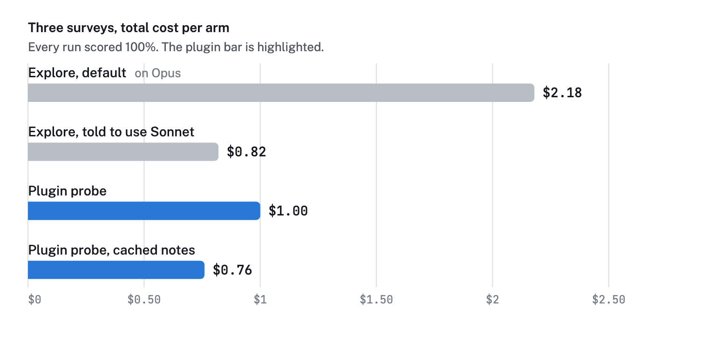
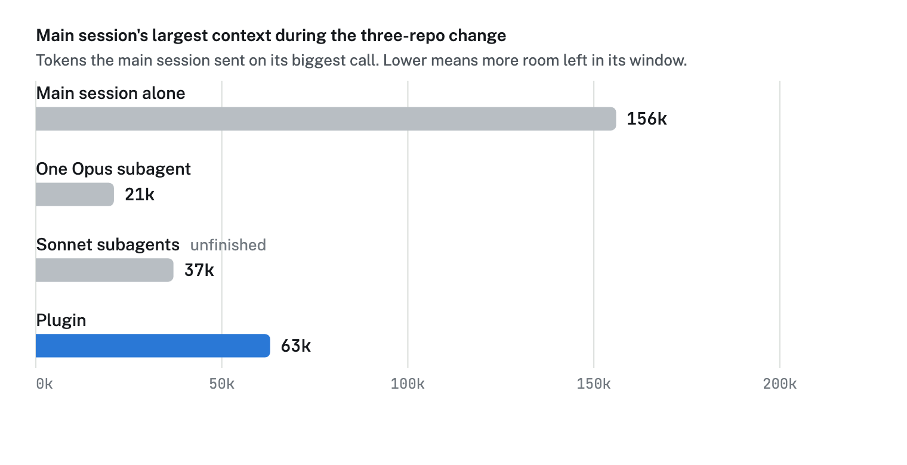
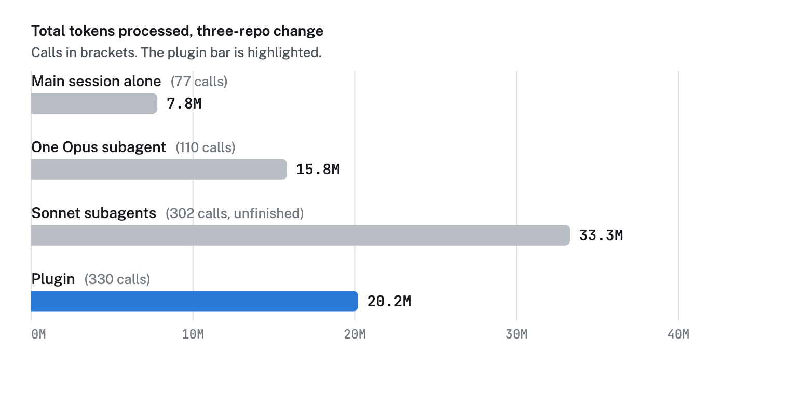
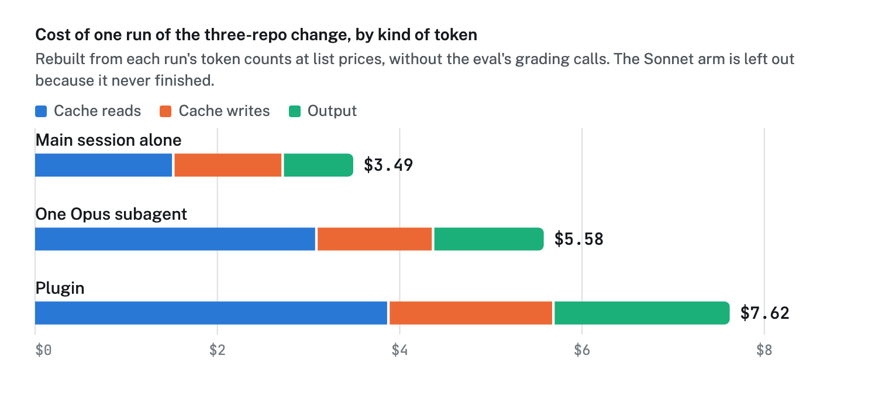
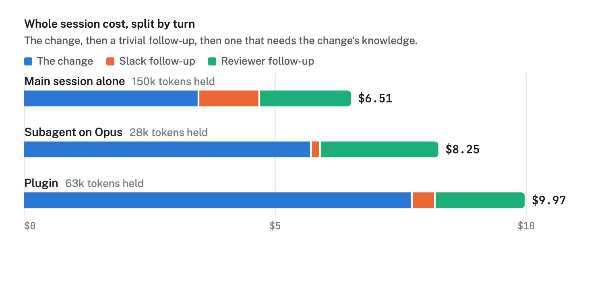

In April I wrote about [replacing one generalist agent with a fleet of specialists](/writing/the-work-isnt-prompting). Six months later I rarely hand the work itself to a subagent. The main session does it, and subagents run my searches and second opinions. What changed my mind was testing my own assumptions instead of trusting them.

## The claim

I've always assumed that handing work to a subagent saves tokens and keeps the main session's context small, so I built a plugin around it.

A subagent is a separate Claude session that the main session hands a task to. It reads in its own context and sends back a short report, so the reading never enters the main session. My plugin sends work in other repos to Sonnet subagents. Its probe surveys a repo and answers questions about it. Its worker makes one scoped change in one repo. Neither one returns a diff, only a short report.

That's two claims. The main session stays small, and the work as a whole takes fewer tokens. The plugin worked, and I drew conclusions from it that I had never tested.

## How I tested it

I gave the same task, word for word, to several arms. An arm is one way of doing the job. The main session ran on Opus 5.5 in every arm.

| Arm                | What it does                                                             |
| ------------------ | ------------------------------------------------------------------------ |
| Main session alone | Opus does the work itself, with no subagent                              |
| Subagent on Opus   | Claude Code's built-in subagent, which inherits the main session's model |
| Subagent on Sonnet | The same subagent, told to use the cheaper model                         |
| My plugin          | Probe and worker subagents on Sonnet                                     |

Every run started from fresh copies of the repos at one pinned commit. A survey had to name the right files and facts. A change was graded on the code it left in the repos: checks on the edited code, a judge reading each diff, and a check that nothing was committed or touched outside scope. The cost of each run is the total API bill that `claude plugin eval` reported.

## Surveys

The first tests were three surveys that asked factual questions about an unfamiliar repo. Every run scored 100%, so cost is the only difference.

Claude Code's built-in search subagent, Explore, runs on the main session's model unless told otherwise. By default every Explore turn ran on Opus.



One sentence of prompt cut the cost by more than half. The plugin only matched that sentence. It edged ahead when it started from notes an earlier run had cached about the repo.

## A change across three repos

The main test moved a checkout page to a new URL across three repos: a purchase app, a routing proxy, and the checkout app. It also removed a finished feature flag. The prompt described the behaviour and named no files. All three repos had to agree on one route. It's the kind of work the plugin was built for.

| Arm                | Time                           | Result             |
| ------------------ | ------------------------------ | ------------------ |
| Main session alone | 7 min                          | Passed every check |
| One Opus subagent  | 12.5 min                       | Passed every check |
| My plugin          | 20 min, 11 subagents           | Shipped one defect |
| Sonnet subagents   | Stopped at the 40-minute limit | Unfinished         |

## The main session stays small

Every subagent arm kept the main session's context well below the arm that did the work itself.



That part of the claim held up. The protection has a price though. What the subagent learned is thrown away when it reports back, so the session can't reuse it.

## Fewer tokens overall

Every call to the model re-sends the whole conversation so far. The tokens a job takes are roughly its context size times its number of calls.

```text
tokens ≈ context size × number of calls
```

Counting every call, main session and subagents together:



The main session alone used the fewest tokens by a wide margin. That part of the claim was false.

Sonnet is cheaper per token, but it took more calls to finish the same job. Every call re-sends the whole context. The Sonnet subagents processed over twice the tokens of the Opus subagent and still didn't finish. On a smaller single-repo change with both models at the same effort, the Sonnet worker needed 16 to 18 calls where Opus needed 8. A cheaper model doesn't mean fewer tokens.

The plugin's extra calls came from three places:

- **Relearning.** Every subagent starts cold, at about 20,000 tokens of setup, and re-reads the code it needs.
- **Handoff mistakes.** A worker acts on a brief instead of the whole problem. Twice a worker wrote the proxy rule so it only matched paths starting with `/purchase/checkout`. That misses locale URLs like `/jp/purchase/checkout`, which every other rule in that file is written to catch.
- **Checking by dispatch.** The plugin never returns a diff to the main session, by design. Every check the main session wanted meant another subagent. Five of the eleven were repairs or checks.

## What the tokens cost

The first time the API sees part of a conversation, it writes it to a cache. After that, re-sending it is a cache read, the cheapest kind of token. Opus 5.5 and Sonnet charge the same for cache reads, $0.20 per million. A cache write costs 12 to 40 times that, and every new subagent writes its own context.



Cache reads were 44% to 56% of each bill, and Sonnet gets no discount on them. The plugin wrote four times as much to the cache as the main session (597,000 tokens against 149,000) because each of its 11 subagents set up its own context. Running on the cheaper model didn't make up for the extra tokens.

## Later turns didn't win it back

A small main session should make every later turn cheaper. I tested that by resuming each arm's session and asking two more things. The first was a two-line Slack announcement. The second was a reviewer's question that needs what the change taught.



The change costs here include the grading calls, so the subagent arms come out a little higher than in the table above.

The small context won the trivial turn. Most of the main session's $1.21 was rebuilding a cold cache though, because I resumed it hours later. With a warm cache the gap is about 2 cents a turn. It would take around ninety turns like that to earn back the change.

On the reviewer's question the small context stopped helping. The subagent arms had to learn the code again, and the Opus arm's fresh subagent re-read about 4 million tokens to do it. The main session answered from what it already held, and got it right.

## Effort

Effort is a per-request setting for how much the model thinks (and how many tool calls it makes) before answering. My first runs had Opus at `medium` and Sonnet at `high`, each model's default. That meant I was changing the model and the effort at once. Matching them saved a couple of calls on a small change and no money.

The cleanest effort result came from my writing plugin. Its editor agent reviews text and suggests edits. I ran it three times at each effort level against a fixed answer key of six defects.

| Editor agent           | Low     | Medium  | High    |
| ---------------------- | ------- | ------- | ------- |
| Defects found, per run | 6, 5, 6 | 6, 6, 6 | 6, 6, 6 |
| Tokens per run         | 24–29k  | 32–34k  | 36–38k  |
| Time per run           | 39–47s  | 66–84s  | 92–108s |

Medium matched high on every defect with fewer tokens. Low was faster and cheaper, but it missed a real defect once and wrote a factually wrong fix another time.

## Then Sonnet 5.5 came out

On 29 September I reran the three-repo change three times per arm. The `sonnet` model alias now pointed at Sonnet 5.5, so every Sonnet subagent ran on it, including my plugin's. I added two arms:

- **One Sonnet subagent per repo.** The main session briefs three Sonnet subagents without reading the code itself.
- **Plan first, then split.** The main session reads the repos and writes a plan with the files and exact changes per repo. It then briefs one Sonnet subagent per repo with only that repo's part.

| Arm, three runs each         | Cost       | Minutes | Total tokens | Proxy rule correct |
| ---------------------------- | ---------- | ------- | ------------ | ------------------ |
| Main session alone           | $3.30–4.25 | 8–12    | 6.9–10.1M    | 3 of 3             |
| My plugin's worker           | $1.61–2.69 | 4–7     | 2.4–4.3M     | 1 of 3             |
| One Sonnet subagent per repo | $1.00–1.95 | 3–6     | 1.5–3.4M     | 0 of 3             |
| Plan first, then split       | $3.73–4.06 | 11–13   | 5.7–6.6M     | 3 of 3             |

Sonnet 5.5 reversed the token result. Both subagent arms without a plan used fewer tokens than the main session alone. They also cost half as much or less and finished faster. Sonnet 5 had needed two to three times the calls of Opus on this change. One Sonnet 5.5 subagent per repo made no more calls than the main session alone.

They got the routing wrong though. The judge failed the proxy diff in 5 of the 6 unplanned Sonnet runs, and every one of those failures was unanimous. My best guess is the same locale paths that tripped the plugin before. The judge's reasons weren't recorded, so that's unconfirmed.

Writing the plan in the main session fixed the quality at the main session's price. My reaction at the time:

> ok so plan first then split did about the same as the main session is what I'm seeing

## What changed for me

The results matched something I'd already been feeling. A week before the retest I asked:

> so really what is the point of using subagents?

My writing plugin used to draft MR descriptions and commit messages in a subagent. I kept fighting it:

> the main session agent already dispatched 4 scribes… I just want the main session to do it

In October I moved drafting into the main session. Drafting subagent runs went from 53 in the first twelve days of October to 6 in the five days after.

I haven't stopped using subagents. I've stopped handing them the work itself. They still run my searches and they still review my code.

## Optimizing is a moving target

The plugin was about 8,300 lines across two repos. Running its evals cost $101.78, and that doesn't count the Opus sessions that built and analysed them. It never merged.

Its case rested on Sonnet being cheaper than Opus, and Opus 5.5's cache pricing removed that. Then Sonnet 5.5 flipped the token result again. The plugin's agents changed model without a commit because they name the alias.

At one point I asked:

> ok so did what we made today actually improve things or are we optimizing for a score?

Optimizing for agent performance mostly isn't worth it. It's expensive, and models get better too quickly for a tuned setup to stay tuned. The optimizations that held up on both model versions cost almost nothing: one sentence telling Explore to use Sonnet, setting effort to medium, and planning in the main session. The expensive one lost on Sonnet 5, and on Sonnet 5.5 it only got cheap by getting the routing wrong.

None of this would have shown up without the A/B tests. Measuring was worth it. Building on an assumption I hadn't measured wasn't.

## What I'd do now

- **Check the call count before trusting a cheaper model.** Sonnet 5 saved per token and spent more of them. Sonnet 5.5 didn't, so this depends on the model version.
- **Use a subagent when I only need its conclusion.** Throwaway searches and surveys are the good case because the reading can be thrown away.
- **Use one for a second opinion.** A context that didn't write the code reviews it without the author's assumptions.
- **Plan changes in the main session.** Either make the change there, or write the plan there and split the execution.
- **Tell Explore to use Sonnet and keep its reply short.** That one sentence was the clearest saving in all of these tests.
- **Lower effort before switching to a cheaper model.**

## Caveats

- **Single runs.** Each figure is one run per arm, except the editor effort table and the Sonnet 5.5 retest. The three-repo gaps are big enough to trust the order. The single-repo gaps aren't.
- **No test suites ran.** The test sandbox had no network and blocked the language toolchains. Changes were graded on the code they left.
- **Grading.** A judge failed two correct changes before I fixed its instructions. On the long three-repo diffs the default judge model was noisy.
- **Model aliases.** The retest used the `sonnet` alias, which moved from Sonnet 5 to Sonnet 5.5 between the two batches. It also graded with a Sonnet judge instead of the default.
- **Not tested.** Whether a subagent that writes text for me is worth it against the main session drafting directly. My move to inline drafting was a judgement call.

Prices used, per million tokens:

| Model            | Input | Output | Cache write | Cache read |
| ---------------- | ----- | ------ | ----------- | ---------- |
| Opus 5.5         | $4    | $20    | $5          | $0.20      |
| Sonnet 5 and 5.5 | $2    | $10    | $2.50       | $0.20      |
