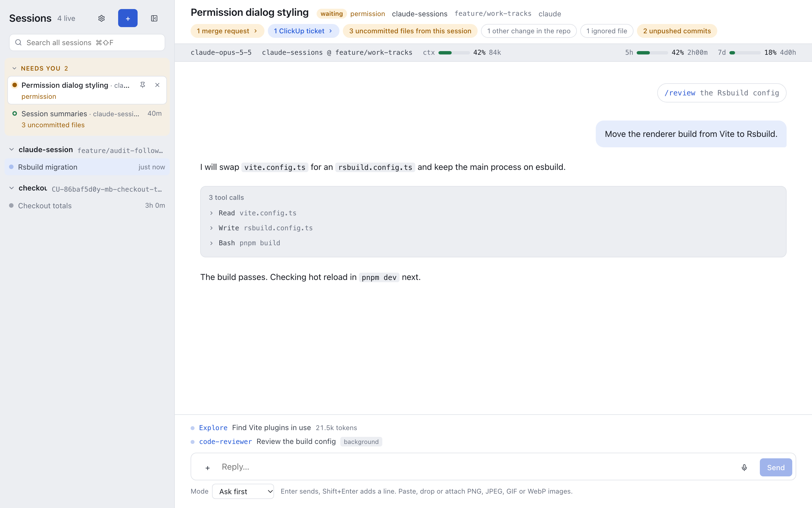
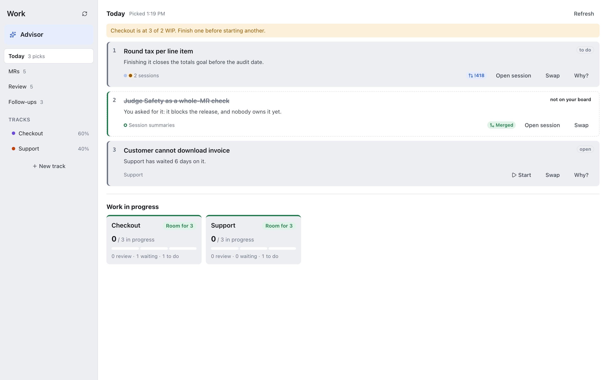
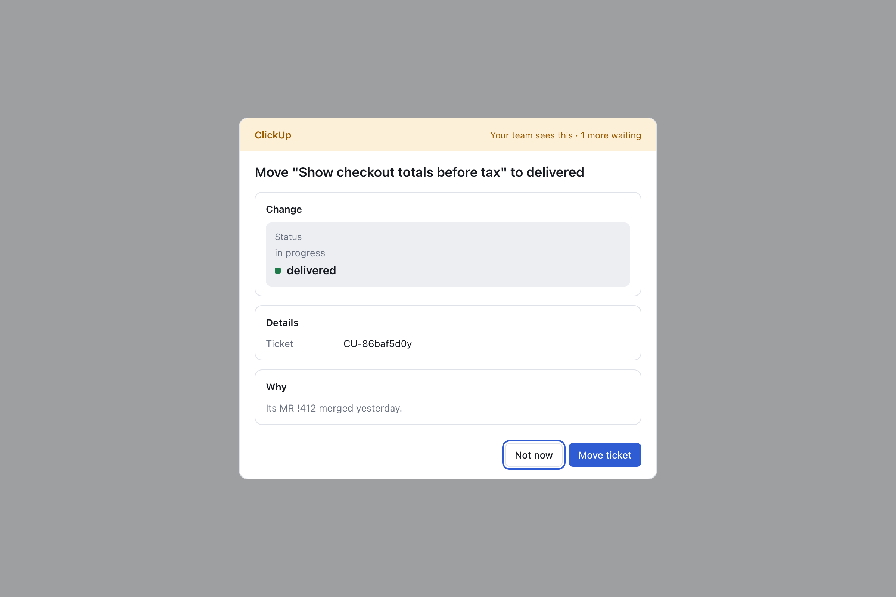
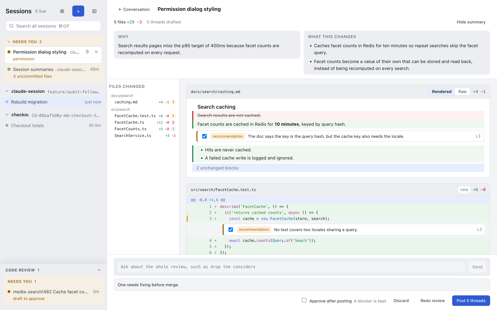
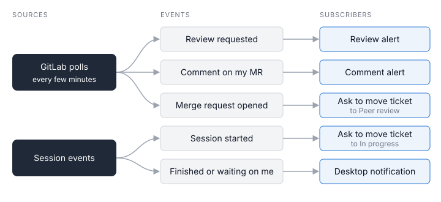

I've always struggled with keeping too many things in my head at once, at work and outside it. I'm an ideas person and I have far more ideas than time. That's true in my workday and in my free time (which I'd mostly rather spend with my family).

At work that shows up as too many tracks at once. In any given week I'm on several: each with its own people, stakeholders, ClickUp board, and open merge requests. My expertise gets pulled in a lot of directions. Prioritizing all of it in my head doesn't work well, and sometimes I drift from what stakeholders actually need.

The process around the code makes it worse. Reviews, tickets, merge requests, and status updates are all things to remember. Has anyone commented on my MR? Is a review waiting on me? Is the ticket up to date? None of it is hard. It just eats the attention I'd rather spend building.

I'm a senior software engineer at a large multinational, and that overhead is a big part of the job. I've gone from Copilot in VS Code to Claude Code on my own projects to building my own tooling on top of it at work. This post covers what I built, why I built it, and what it costs me.

The short version: the judgment stays with me. AI handles the overhead that used to sit between my ideas and the work.

## From Copilot to Claude Code

For a long time Copilot in VS Code was the only AI tool approved at work. It wasn't my first choice. It was what I had, so I got used to it and made it work.

Making it work mostly meant trying to rebuild my Claude setup inside Copilot. I ported skills into instructions and tried to get hooks working. Getting hooks to run natively took a lot of undocumented workarounds, and even then they didn't fire reliably. It was terrible. The more Copilot morphed, the worse the product got. It still helped me write code, but that was about it.

But writing code is only part of my day. The rest is reviewing merge requests, creating ClickUp tickets, opening MRs, and keeping all of it in sync. Copilot didn't do any of that by default, so all that overhead was still mine to deal with.

I've used Claude Code on my own time since around February or March. It made a huge difference on my personal projects, and I pushed hard for it at work.

The company was more cautious. They wanted to do their own research and testing first, which is fair. I didn't want to put work on my personal subscription, so the workflow I had in mind stayed on hold until they gave me a seat.

Once I had it, the difference was obvious. Claude Code is just way better than Copilot at building things. It still didn't cover my whole workflow on its own. But it made it really easy to build the parts that were missing.

## My name is on everything

There are MCP servers for GitLab and ClickUp already. I wasn't comfortable giving Claude unrestricted access to them.

Claude has never done anything truly dangerous for me, but I've heard the horror stories. And whatever goes out under my name is my responsibility. "The AI did it" doesn't change that.

So I wrote thin wrappers around the GitLab and ClickUp APIs and turned them into CLIs. They only expose what my workflow needs, and they follow my approval process. Then I packaged them as plugins so they're easy to install and share.

## Outgrowing the terminal

I tried using skills to get Claude to reach for those tools. It didn't use them reliably. Back in February I was already telling it:

> I feel like you never use the project specific skills

Some skills conflicted with others, so behavior got unpredictable.

I also realized I don't like working in the terminal anymore. It's hard to read, and as I put it in one session:

> Markdown support in terminal is pretty shit

It also doesn't keep track of the references I care about, like merge requests and ClickUp tickets. I was "always chasing 'what's the MR, what's the full path for that file, what are the changes, etc'" and asking for the same information again, which burns turns.

The Claude desktop app is the opposite. The typography is easy to read and I have better conversations there. But it doesn't have what my professional workflow needs, and every connector at work needs approval. That's a lot of overhead for an experiment that might not do what I want.

In September I finally said it out loud:

> I just want a desktop wrapper on my shell. I hate reading your text in terminal

## Claude Sessions

So I built a session manager for Claude Code that keeps every session in a side panel. I don't hunt through iTerm tabs anymore to see if anything needs my attention.

<small><em>Every session sits in the side panel. The ones waiting on me sit at the top under Needs you.</em></small>

I had a working version that did exactly what I wanted in a day. I knew Claude Code made building easy, but it has gotten much better in the six months I've used it. I didn't expect that much from so little work. It wasn't pretty though. My review of it on day one:

> Overall the UI sucks ass and is hard to read.

Over the next week I turned it into an Electron app. I'm the user and the developer, so I decide what the guardrails are. Instead of hoping AI decides to use something, I just write code that does it.

A few things it does now:

- **Desktop notifications** when a session finishes or Claude needs my input. I answer quickly and move on.
- **Review alerts.** It polls GitLab every five minutes and notifies me when I'm assigned a review. Nobody has to Slack me that something is ready.
- **Comment alerts.** Comments on my merge requests reach me within five minutes. I used to track that in my head across every open MR.

With that in place I can run about five things at once while still building the tool I'm using.

## The advisor

I've looked at OpenClaw and its offshoots, and I've built something similar for myself. I didn't want that at work. It comes with a lot of baggage, and giving an AI unrestricted access to everything is a bad idea.

The part I did want was a personal assistant for the planning overhead: what's on track, what's slipping, and whether I'm aligned with the business.

That's the weakness I opened with, and it's the one I most wanted help on.

So Claude Sessions has a Work tab with an advisor agent. It has its own MCP set and its own memory. It knows every work track I'm on and the ClickUp boards behind them.

<small><em>Today's picks from the advisor. Each one has a reason and a button to start or open its session.</em></small>

- **Up to three priorities a day**, pulled from all my boards and ranked by my goals and hard deadlines. Someone leaving the company or my paternity leave means some things have a real cutoff.
- **A fresh session each day**, seeded with a Haiku summary of the day before.
- **Read access by default.** It reaches ClickUp and GitLab through an MCP server inside the app, which calls the same CLIs I wrote.
- **Asks before it changes anything.** A status change (like moving a task to delivered) comes with a reason. I approve or deny.
- **Stale work flags.** A task that hasn't moved in nine days, an MR open for two months, an MR with no approvals. It suggests putting things on hold or drafts a nudge I can send.
- **A play button.** Each priority links to a session. If none exists, one click starts a Claude Code session with the right context. If one is open, the same button takes me there.

<small><em>The advisor asks before it changes anything in ClickUp. Its reason sits under Why.</em></small>

I get through ClickUp updates way faster now, and I spend less time figuring out what to start on.

## Code reviews

When I'm assigned a merge request, one click runs the stock AI review and stages the findings. I go through each one and decide whether it's real or noise. Only the findings I agree with get posted on my behalf.

<small><em>A staged review. Each finding has a checkbox to keep or drop it, and nothing goes out until I click Post.</em></small>

The AI drafts, I decide. Reviews go much faster, and nothing goes out that I haven't checked.

## The glue: events

A lot happens in the app now, so each source has its own event emitter. Any feature can subscribe to the events it cares about.

<small><em>GitLab polls and session events feed the alerts and the ClickUp status changes.</em></small>

| Event                            | What happens                                    |
| -------------------------------- | ----------------------------------------------- |
| GitLab poll (every five minutes) | Review alerts and comment alerts                |
| Session started                  | Proposes moving the ClickUp task to In progress |
| Merge request created            | Proposes moving the ClickUp task to Peer review |

I approve the move and the ticket follows the work, so I never stop to update it. Adding a feature means adding a listener, which is why the app grew so fast.

## Voice profiles

Two things bother me about how Claude writes. I've told it as much:

> I hate how you word things. It all reads like ai generated slop

First, it explains too much. I work better in a conversation than when something lectures me, so I use output styles to keep it short. Sometimes I can't even tell what it means:

> "Predicates decay, and the good ones decay because the actor adapts." what the fuck does that even mean?

The second matters more. When Claude drafts a Slack message or an MR description for me, it attributes things to me that I never said. Opinions I don't hold, things I didn't do. Even good opinions don't belong in my mouth if they aren't mine.

So I built a separate system for drafting. It has a guide for each kind of artifact, like MR descriptions and Slack messages. It lists Claude's usual tics, and it bans words like "footgun" and "load-bearing." The footgun ban has a clear origin:

> I hate the word footgun and it's constantly used by claude models. Gotcha is much more common

It plugs into Claude Sessions like everything else.

## The downsides

Building my own layer has costs, and two of them really matter to me.

**I maintain it.** I'm the developer and the only user. When something breaks or an API changes, nobody else is fixing it. That's time I'm not spending on my actual job.

**I depend on Anthropic's terms.** Claude Sessions runs Claude Code in headless mode through my company's team subscription. If Anthropic stops allowing that on a subscription, I'm in trouble. By my math a full week of my subscription's usage limit would cost about $1,000 to $2,000 at API prices. I consistently use 80% or more of it, so that's roughly $800 to $1,600 a week. It's a small risk but it's real. It's also outside my control.

If that happens, I'd have to swap model providers or mirror terminal sessions inside the app. Mirroring is doable. Terminal sessions usually have unrestricted access though, which undoes the guardrails I built. Neither option is a quick fix.

## Back to building

GitLab, ClickUp, and my own work are finally connected. I don't have to create, update, and track all of it in my head anymore.

That's where AI actually fits in my workflow. It handles the overhead, and the judgment stays with me. What I got back is time to do what I wanted to do in the first place: build things, write code, and ship.
